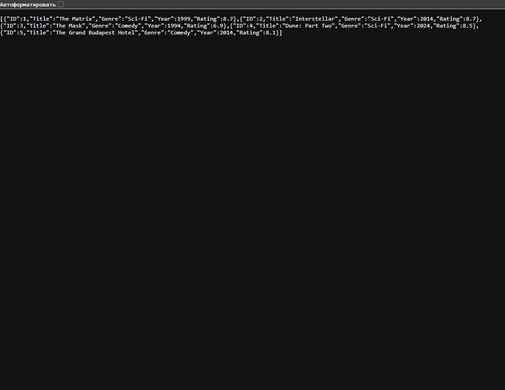

# Домашнее задание 12 — каталог фильмов

## Краткий отчёт

Каталог фильмов с фильтрами, добавлением и удалением.

## Выполнение по заданию

### 1. Данные

Структура `Movie` содержит ID, название, жанр, год и рейтинг. В памяти изначально пять фильмов.

### 2. Маршруты

`GET /movies`, `GET /movies/{id}`, `GET /movies/genre/{genre}`, `GET /movies?minRating=8&year=2024`, `POST /movies`, `DELETE /movies/{id}`.

### 3. Проверка

Проверены совместные фильтры, поиск по жанру, создание 201, удаление 204, ошибки 400 и 404.

## Запуск

```powershell
go run .
```

Открыть `http://localhost:8080` и нужные адреса. Остановка — Ctrl+C. POST и DELETE можно выполнить через Postman или `curl.exe`. Данные хранятся до завершения программы.

## Пример добавления

Пока сервер работает, откройте второе окно PowerShell:

```powershell
$body = @{ Title="Новый фильм"; Genre="Comedy"; Year=2024; Rating=8.2 } | ConvertTo-Json
Invoke-RestMethod -Method Post -Uri http://localhost:8080/movies -ContentType "application/json; charset=utf-8" -Body ([System.Text.Encoding]::UTF8.GetBytes($body))
```

## Скриншот выполнения



## Вывод

Оба фильтра применяются вместе. Новому фильму присваивается ID, некорректный запрос получает 400.
